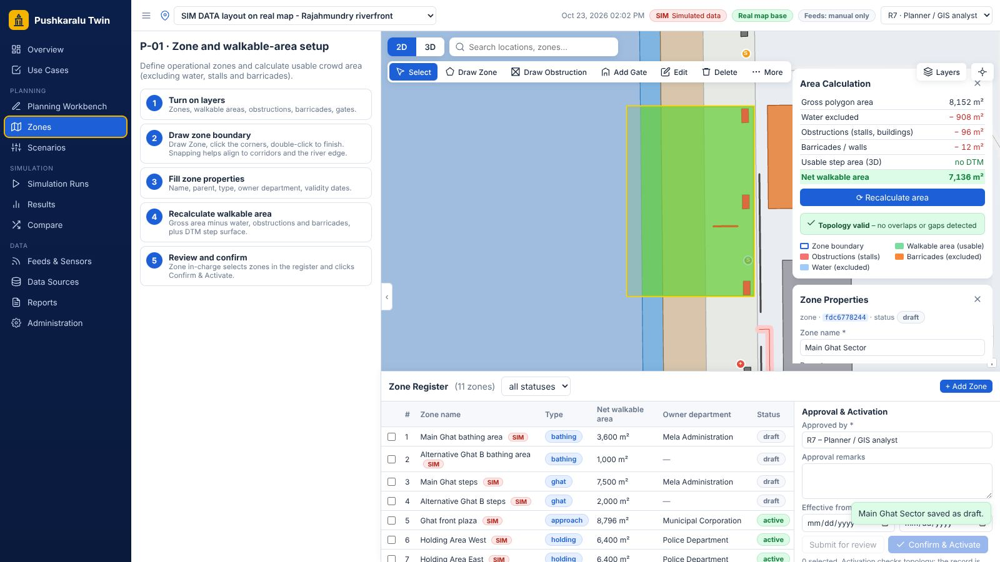
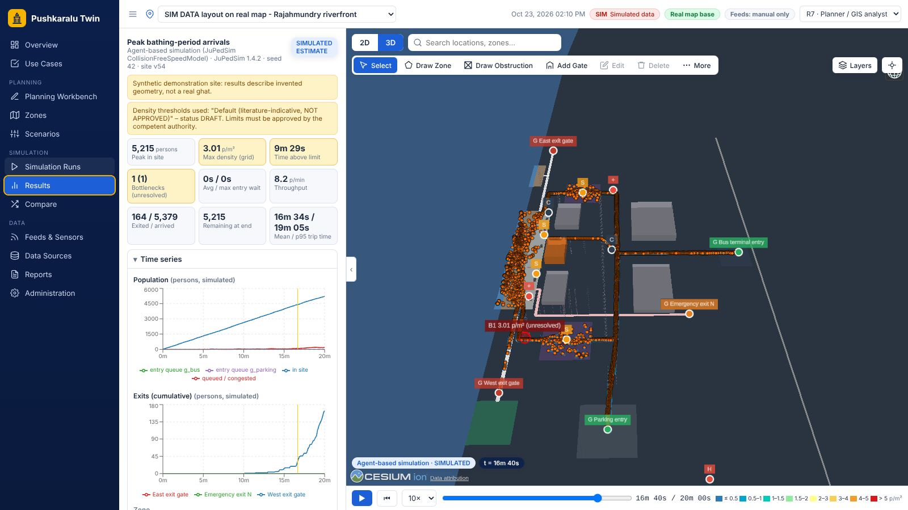
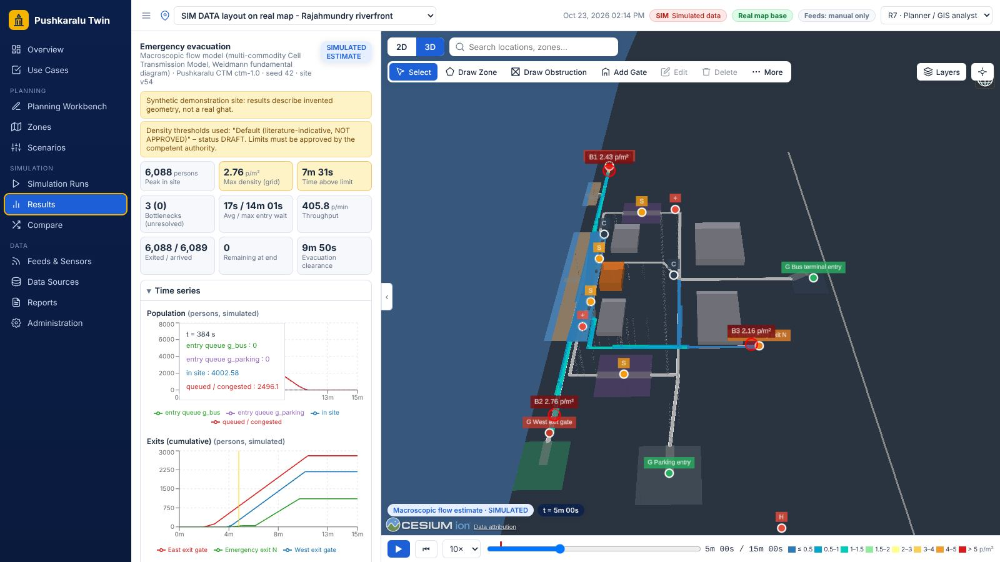
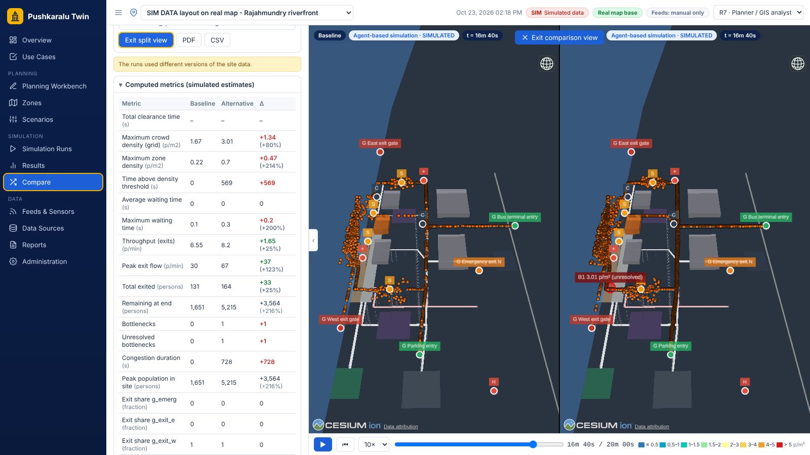

# Pushkaralu Crowd Digital Twin

An open-source, browser-based 3D Web GIS Digital Twin for Pushkaralu crowd
management: import site GIS data, define pedestrian corridors, gates and
holding areas, run **real pedestrian simulations** (agent-based with
[JuPedSim](https://www.jupedsim.org/), or a macroscopic Cell Transmission Model),
analyse density, bottlenecks, holding-area capacity and evacuation clearance,
compare alternatives, and export CSV/PDF/GeoJSON outputs for SOP drafting and drills.

> **Status: working prototype (phases 1–5 vertical slice).** All results are
> simulated estimates. Thresholds, demand figures and site geometry must be
> validated, and every safety-critical decision approved by authorised officials.

> **Demonstration data.** Two SIM DATA layouts are bundled: one offshore
> (85.0°E, 15.0°N, with a synthetic river and DEM) and the same layout placed on
> a straight stretch of the real OpenStreetMap Godavari bank at Rajahmundry so it
> can be seen over the real map. The layout is invented and labelled SIM DATA in
> the application; it does not represent the real ghats. The only real dataset
> bundled is the OSM river polygon (ODbL). Load surveyed data via
> [docs/DATA_FOLDER.md](docs/DATA_FOLDER.md).

| Zones: walkable-area calculation (P-01) | 3D operational view (agent-based, peak arrivals) |
|---|---|
|  |  |
| **Macroscopic evacuation (computed corridor flows)** | **Synchronised comparison** |
|  |  |

All screenshots show SIM DATA and simulated estimates. Map tiles were unreachable where they were captured, so the basemap appears plain; on a connected computer the real map is shown behind the layout.

## What it does

| Area | Implemented |
|---|---|
| UI | Light operations-centre layout: navigation rail, site selector, SIM / real-map badges, role switcher, map toolbar (2D/3D, search, Select, Draw Zone, Draw Obstruction, Add Gate, Edit, Delete, More), Layers menu with basemaps, snapping & validation |
| Basemaps | OpenStreetMap streets, Esri satellite, CARTO light/dark, custom XYZ, or none – behind both 2D and 3D views |
| 3D viewer | CesiumJS globe, terrain from DTM/DEM or quantized-mesh, extruded buildings/temples, walls, corridors, gates and service symbols, 3D Tiles, glTF models, orthophotos, picking + inspector |
| Zones (P-01) | Zone properties (parent, type, owner department, validity), net walkable area (gross − water − obstructions − barricades + DTM step surface), topology checks, zone register with review / Confirm & Activate |
| Data folder | `data/sites/<site>/` auto-loaded: vectors, DTM/DEM, terrain tiles, 3D Tiles, glTF, orthophotos, licences via `site.json` |
| 2D planning | OpenLayers map with draw / modify / select for every feature type, attribute editing, network overlay |
| GIS import | data folder or single-file upload: GeoJSON, GeoPackage, Shapefile, KML … via GDAL/OGR (pyogrio), any CRS → WGS84; DEM rasters via GDAL (rasterio); licence + provenance per dataset |
| Network | Pedestrian network built from corridors (width, direction, stairs/ramps, emergency-only, blocked), gates and area nodes; Dijkstra, Yen k-shortest + logit, CCRP capacity-constrained evacuation routing |
| Simulation | **Agent-based**: JuPedSim Collision-Free Speed Model or Social Force Model, Poisson arrivals, entry queues, holding/bathing dwell, diversions, mid-run closures, evacuation re-routing. **Macroscopic**: multi-commodity Cell Transmission Model with a Weidmann fundamental diagram. Every run is labelled with its method. |
| Analytics | Zone counts & densities, density grid, corridor throughput, entry queues & waiting times, travel times, time above limit, bottleneck detection, exit utilisation, clearance by zone, holding-area occupancy / time-to-limit / alternatives |
| Scenarios | Full editor + 10 presets generated from any site's features; server-side validation |
| Runs | Background worker processes, progress over server-sent events, cancel, reproduce (stored data snapshot + seed + thresholds) |
| Comparison | Metric table with computed differences, overlaid time series, synchronised side-by-side 3D viewers |
| Outputs | PDF report (maps, charts, assumptions, provenance, limitations, interventions, review/approval fields), CSV zip, density / bottleneck / layout GeoJSON, comparison PDF/CSV |
| Observations | Manual/CSV observed and forecast counts, displayed separately from simulated values (no live sensor integration yet) |

## Quick start on Windows (laptop)

Install **Python 3.11–3.13 (64-bit)** from python.org (tick *Add python.exe to PATH*) and **Node.js LTS**. Then, in the project folder:

```bat
setup_windows.bat        :: once: creates .venv, installs backend + frontend, builds the web app
start_windows.bat        :: starts http://127.0.0.1:8000 and opens the browser
start_windows.bat dev    :: development mode: API on :8000 + live-reloading UI on :5173
scan_data_windows.bat    :: load new/changed files from data\sites\ without starting the server
test_windows.bat         :: run the automated tests
```

## Bringing in real data (DTM/DEM, 3D models, GIS)

Drop files into **`data/sites/<your-site>/`** – `vector/` (GeoJSON, GeoPackage, Shapefile, KML),
`dem/` (DTM/DEM/DSM GeoTIFF), `terrain/` (quantized-mesh), `tiles3d/<name>/tileset.json`
(buildings, photogrammetry, LiDAR as 3D Tiles), `models/` (glTF/GLB) and `imagery/`
(orthophotos), plus an optional `site.json` for licences, type mapping and model placement.
The folder is loaded at start-up and with **Data Sources → Scan data folder**; changed
files are re-imported. Details and conversion recipes: [docs/DATA_FOLDER.md](docs/DATA_FOLDER.md).

## Quick start (Linux / macOS, no Docker)

Requirements: Python 3.11–3.13, Node.js 20+.

```bash
# backend
python3 -m venv .venv && . .venv/bin/activate
pip install -r backend/requirements-dev.txt
cd backend && uvicorn app.main:app --port 8000      # http://localhost:8000/docs
```

On first start the database (SQLite in `var/`) is created and the data folder is
loaded: the offshore SYNTHETIC demo (with synthetic DEM), the **SIM DATA layout on
the real map at Rajahmundry** (real OSM river, illustrative layout) and an empty OSM
reference workspace, with the 10 preset scenarios.

```bash
# frontend (second terminal)
cd frontend
npm install          # also copies Cesium's static assets to public/cesium
npm run dev          # http://localhost:5173 (proxies /api to :8000)
```

Then: **Scenarios → ▶ Run** on a preset, watch progress in **Simulation Runs**, click
**View results**, press ▶ in the timeline to replay agents and the density
heatmap, and try **Compare** with two runs. **Zones** walks through zone drawing,
walkable-area calculation and approval (use case P-01).

## User journeys

[docs/user-journeys.pdf](docs/user-journeys.pdf) shows every use case (P-01 … P-14)
step by step with screenshots of the application (also linked in the app under
Use Cases and Reports). Regenerate with `node tools/user_journeys/capture.mjs`
and `node tools/user_journeys/build_pdf.mjs` while the app runs.

### With Docker (PostgreSQL/PostGIS)

```bash
cp .env.example .env
docker compose up --build              # app + PostGIS on http://localhost:8000
docker compose --profile gis up        # + GeoServer on :8080 (publish view v_site_features)
```

The image builds the frontend and serves it from FastAPI. (The Docker setup is
provided but could not be executed in the environment this prototype was built
in; the API test-suite was run against SQLite and against a real PostgreSQL 16
server without the PostGIS extension.)

## Measured on the demo site (4-core container, synthetic data)

| Preset | Method | Population | Runtime | Notes |
|---|---|---|---|---|
| Normal (1 200 s) | agent-based | 1 693 peak | 97 s | no bottlenecks |
| Peak bathing (1 200 s) | agent-based | 5 214 peak | 375 s | 2 unresolved bottlenecks, 4.9 p/m² max |
| Evacuation (900 s) | agent-based | 6 103 | 918 s | **not cleared** in 840 s after trigger (3 784 out) |
| Evacuation (900 s) | macroscopic CTM | 6 088 | 6 s | cleared in 655 s |

The two evacuation estimates differ substantially: the CTM gives each direction
of a two-way corridor full capacity and has no local jamming at merges, so it
is optimistic. This is why every result carries its method label and why
simulated clearance times alone must not be used to call a plan safe.

## Tests

```bash
cd backend && pytest                    # 35 tests: model, routing, both engines, API, import, data folder, zones, reports
PK_TEST_PG_URL=postgresql+psycopg://user@host/db pytest tests/test_api.py   # same API tests on PostgreSQL
cd frontend && npm test && npm run build   # unit tests + type-check + production build
```

## Documentation

* [docs/ARCHITECTURE.md](docs/ARCHITECTURE.md) – components, data flow, technology choices (Vadere vs JuPedSim vs SUMO)
* [docs/MODELS.md](docs/MODELS.md) – simulation and analytics methods, assumptions, units, limitations
* [docs/API.md](docs/API.md) – REST API (interactive OpenAPI docs at `/docs`)
* [docs/DATABASE.md](docs/DATABASE.md) – schema and migrations
* [docs/DATA_FOLDER.md](docs/DATA_FOLDER.md) – data drop folder for DTM/DEM, 3D models, 3D Tiles, imagery and GIS
* [docs/DATA_REPLACEMENT.md](docs/DATA_REPLACEMENT.md) – feature types and replacing synthetic data with surveyed Pushkaralu GIS data
* [docs/user-journeys.pdf](docs/user-journeys.pdf) – user journeys with screenshots for all use cases
* [docs/LICENSES.md](docs/LICENSES.md) – dependency and data licences
* [docs/ROADMAP.md](docs/ROADMAP.md) – phases, acceptance criteria status, known limitations

## Repository layout

```
backend/
  app/
    geo/        catalog (feature types), site model (walkable area + network), routing (Dijkstra, Yen, CCRP), CRS
    sim/        scenario schema, presets, trip planning, JuPedSim engine, CTM engine, recorder, analytics, thresholds, runner
    services/   GIS importer (GDAL), site services/seeding, background job manager
    reports/    PDF (ReportLab) and CSV/GeoJSON exports
    api/        FastAPI routers (sites, scenarios, runs/compare/reports, meta)
  migrations/   Alembic (0001 schema, 0002 PostGIS geometry column/trigger/index/view)
  scripts/      synthetic site + DEM generator, OSM river extractor
  tests/
frontend/
  src/components  CesiumView (3D), PlanMap (2D), scenario editor, runs, results, compare, data, method panels
  src/lib         colour scales, replay helpers, terrain sampling, scenario pre-checks (+ unit tests)
data/
  sites/        data drop folder - one sub-folder per site (bundled: 3 demo folders, SIM DATA + real OSM river)
  reference/    godavari_rajahmundry_osm.geojson (OpenStreetMap, ODbL)
  examples/     example observation CSV
tools/user_journeys/  scripts that capture screenshots and build docs/user-journeys.pdf
*.bat         Windows setup / start / scan / test
docs/
```

## Licence

Project code: MIT (see `LICENSE`). Dependencies keep their own licences
(JuPedSim is LGPL-3.0-or-later and is used as an unmodified library). Bundled
OSM data is ODbL-1.0 – attribution "© OpenStreetMap contributors".
