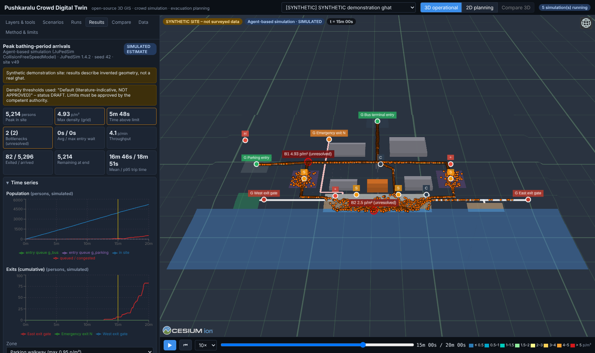
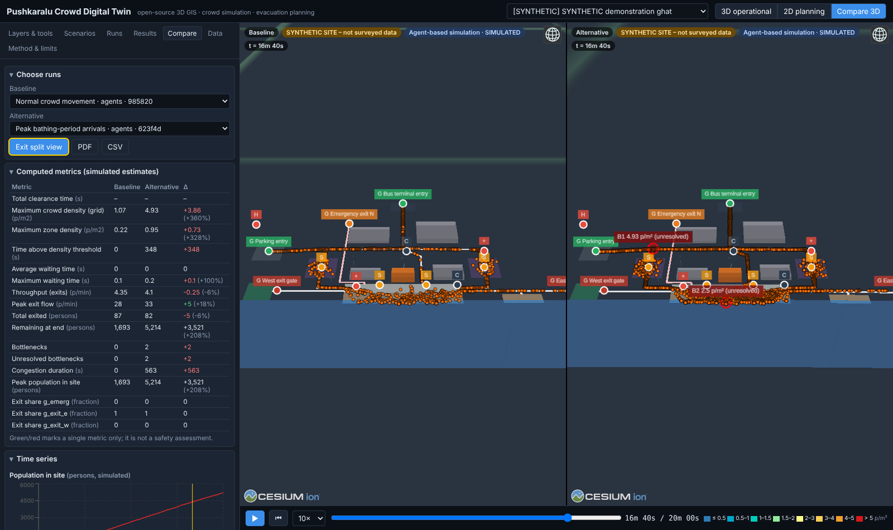
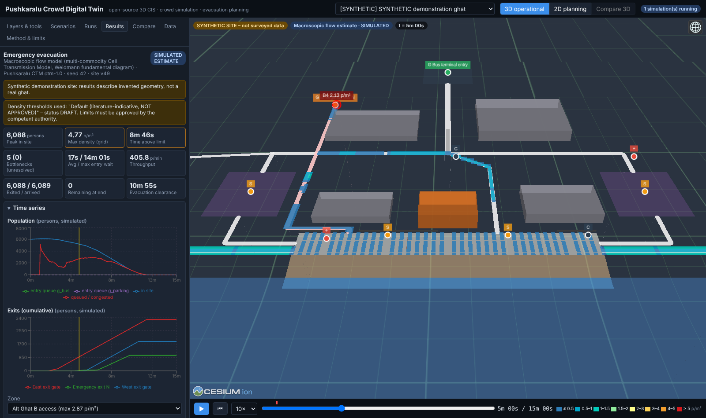
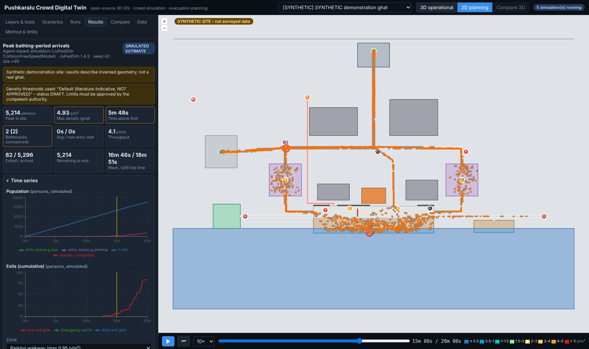

# Pushkaralu Crowd Digital Twin

An open-source, browser-based 3D Web GIS Digital Twin for Pushkaralu crowd
management: import site GIS data, define pedestrian corridors, gates and
holding areas, run **real pedestrian simulations** (agent-based with
[JuPedSim](https://www.jupedsim.org/), or a macroscopic Cell Transmission Model),
analyse density, bottlenecks, holding-area capacity and evacuation clearance,
compare alternatives, and export CSV/PDF/GeoJSON outputs for SOP drafting and drills.

> **Status: working prototype (phases 1–5 vertical slice).** All results are
> simulated estimates. Thresholds, demand figures and site geometry must be
> validated, and every safety-critical decision approved by authorised officials.

> **Demonstration data.** The bundled "SYNTHETIC demonstration ghat" is invented
> geometry, deliberately placed offshore (85.0°E, 15.0°N) so it cannot be
> mistaken for a real place. The only real dataset bundled is an OpenStreetMap-derived
> Godavari river polygon near Rajahmundry (ODbL). No real ghat geometry is
> invented or presented as surveyed. See [docs/DATA_REPLACEMENT.md](docs/DATA_REPLACEMENT.md).

| 3D operational view (agent-based, peak arrivals) | Synchronised comparison |
|---|---|
|  |  |
| **Macroscopic evacuation (computed corridor flows)** | **2D planning map** |
|  |  |

All screenshots show the SYNTHETIC demonstration site and simulated estimates.

## What it does

| Area | Implemented |
|---|---|
| 3D viewer | CesiumJS globe, terrain from imported DEM (custom heightmap provider), extruded buildings/temples, walls, corridors, gates and service symbols, 3D Tiles URL per site, layer toggles, picking + inspector |
| 2D planning | OpenLayers map with draw / modify / select for every feature type, attribute editing, network overlay |
| GIS import | GeoJSON, GeoPackage, zipped Shapefile, KML … via GDAL/OGR (pyogrio), any CRS → WGS84; DEM rasters via GDAL (rasterio); mandatory licence + provenance per dataset |
| Network | Pedestrian network built from corridors (width, direction, stairs/ramps, emergency-only, blocked), gates and area nodes; Dijkstra, Yen k-shortest + logit, CCRP capacity-constrained evacuation routing |
| Simulation | **Agent-based**: JuPedSim Collision-Free Speed Model or Social Force Model, Poisson arrivals, entry queues, holding/bathing dwell, diversions, mid-run closures, evacuation re-routing. **Macroscopic**: multi-commodity Cell Transmission Model with a Weidmann fundamental diagram. Every run is labelled with its method. |
| Analytics | Zone counts & densities, density grid, corridor throughput, entry queues & waiting times, travel times, time above limit, bottleneck detection, exit utilisation, clearance by zone, holding-area occupancy / time-to-limit / alternatives |
| Scenarios | Full editor + 10 presets generated from any site's features; server-side validation |
| Runs | Background worker processes, progress over server-sent events, cancel, reproduce (stored data snapshot + seed + thresholds) |
| Comparison | Metric table with computed differences, overlaid time series, synchronised side-by-side 3D viewers |
| Outputs | PDF report (maps, charts, assumptions, provenance, limitations, interventions, review/approval fields), CSV zip, density / bottleneck / layout GeoJSON, comparison PDF/CSV |
| Observations | Manual/CSV observed and forecast counts, displayed separately from simulated values (no live sensor integration yet) |

## Quick start (local, no Docker)

Requirements: Python 3.11–3.13, Node.js 20+.

```bash
# backend
python3 -m venv .venv && . .venv/bin/activate
pip install -r backend/requirements-dev.txt
cd backend && uvicorn app.main:app --port 8000      # http://localhost:8000/docs
```

On first start the database (SQLite in `var/`) is migrated and seeded with the
synthetic demo site (+ synthetic DEM), the OSM river reference layer and the 10
preset scenarios.

```bash
# frontend (second terminal)
cd frontend
npm install          # also copies Cesium's static assets to public/cesium
npm run dev          # http://localhost:5173 (proxies /api to :8000)
```

Then: **Scenarios → ▶ Run** on a preset, watch progress in **Runs**, click
**View results**, press ▶ in the timeline to replay agents and the density
heatmap, and try **Compare** with two runs.

### With Docker (PostgreSQL/PostGIS)

```bash
cp .env.example .env
docker compose up --build              # app + PostGIS on http://localhost:8000
docker compose --profile gis up        # + GeoServer on :8080 (publish view v_site_features)
```

The image builds the frontend and serves it from FastAPI. (The Docker setup is
provided but could not be executed in the environment this prototype was built
in; the API test-suite was run against SQLite and against a real PostgreSQL 16
server without the PostGIS extension.)

## Measured on the demo site (4-core container, synthetic data)

| Preset | Method | Population | Runtime | Notes |
|---|---|---|---|---|
| Normal (1 200 s) | agent-based | 1 693 peak | 97 s | no bottlenecks |
| Peak bathing (1 200 s) | agent-based | 5 214 peak | 375 s | 2 unresolved bottlenecks, 4.9 p/m² max |
| Evacuation (900 s) | agent-based | 6 103 | 918 s | **not cleared** in 840 s after trigger (3 784 out) |
| Evacuation (900 s) | macroscopic CTM | 6 088 | 6 s | cleared in 655 s |

The two evacuation estimates differ substantially: the CTM gives each direction
of a two-way corridor full capacity and has no local jamming at merges, so it
is optimistic. This is why every result carries its method label and why
simulated clearance times alone must not be used to call a plan safe.

## Tests

```bash
cd backend && pytest                    # 33 tests: model, routing, both engines, API, import, reports
PK_TEST_PG_URL=postgresql+psycopg://user@host/db pytest tests/test_api.py   # same API tests on PostgreSQL
cd frontend && npm test && npm run build   # unit tests + type-check + production build
```

## Documentation

* [docs/ARCHITECTURE.md](docs/ARCHITECTURE.md) – components, data flow, technology choices (Vadere vs JuPedSim vs SUMO)
* [docs/MODELS.md](docs/MODELS.md) – simulation and analytics methods, assumptions, units, limitations
* [docs/API.md](docs/API.md) – REST API (interactive OpenAPI docs at `/docs`)
* [docs/DATABASE.md](docs/DATABASE.md) – schema and migrations
* [docs/DATA_REPLACEMENT.md](docs/DATA_REPLACEMENT.md) – replacing synthetic data with surveyed Pushkaralu GIS data
* [docs/LICENSES.md](docs/LICENSES.md) – dependency and data licences
* [docs/ROADMAP.md](docs/ROADMAP.md) – phases, acceptance criteria status, known limitations

## Repository layout

```
backend/
  app/
    geo/        catalog (feature types), site model (walkable area + network), routing (Dijkstra, Yen, CCRP), CRS
    sim/        scenario schema, presets, trip planning, JuPedSim engine, CTM engine, recorder, analytics, thresholds, runner
    services/   GIS importer (GDAL), site services/seeding, background job manager
    reports/    PDF (ReportLab) and CSV/GeoJSON exports
    api/        FastAPI routers (sites, scenarios, runs/compare/reports, meta)
  migrations/   Alembic (0001 schema, 0002 PostGIS geometry column/trigger/index/view)
  scripts/      synthetic site + DEM generator, OSM river extractor
  tests/
frontend/
  src/components  CesiumView (3D), PlanMap (2D), scenario editor, runs, results, compare, data, method panels
  src/lib         colour scales, replay helpers, terrain sampling, scenario pre-checks (+ unit tests)
data/
  synthetic/    demo_site.geojson, demo_dem.tif  (SYNTHETIC, CC0)
  real/         godavari_rajahmundry_osm.geojson (OpenStreetMap, ODbL)
docs/
```

## Licence

Project code: MIT (see `LICENSE`). Dependencies keep their own licences
(JuPedSim is LGPL-3.0-or-later and is used as an unmodified library). Bundled
OSM data is ODbL-1.0 – attribution "© OpenStreetMap contributors".
